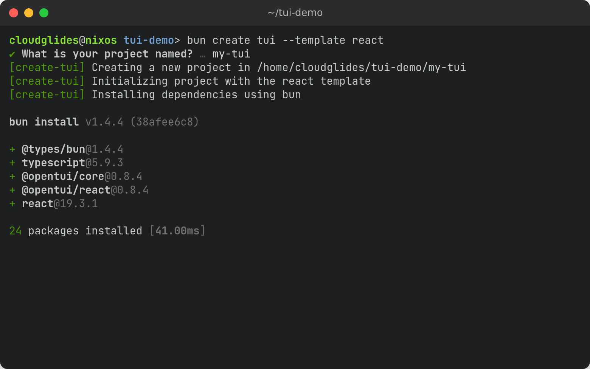
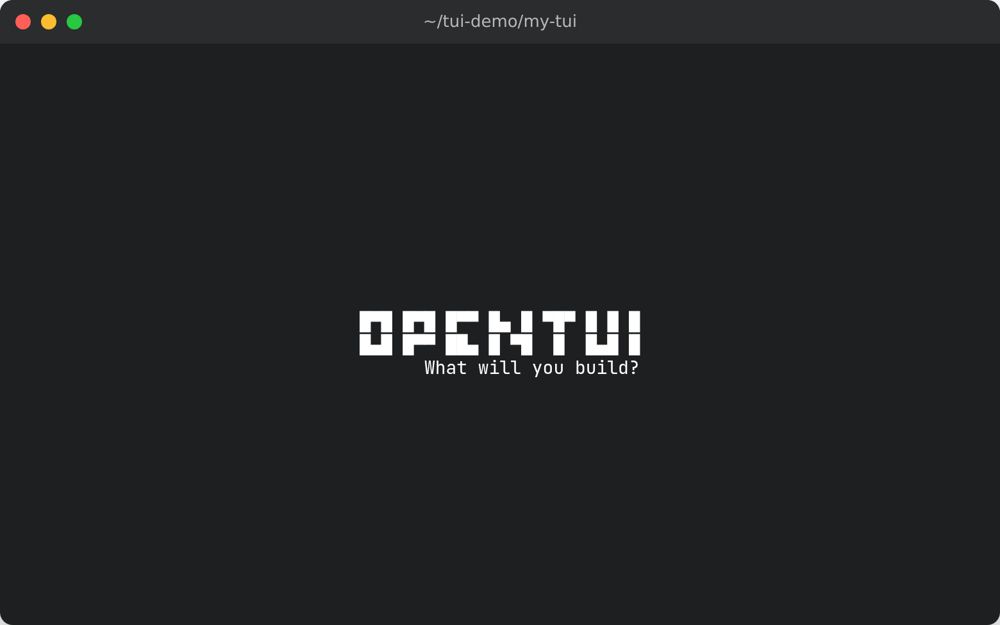
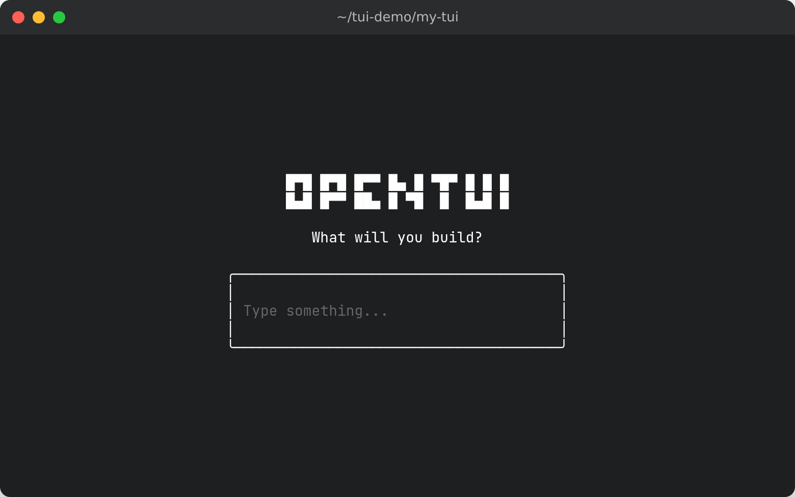
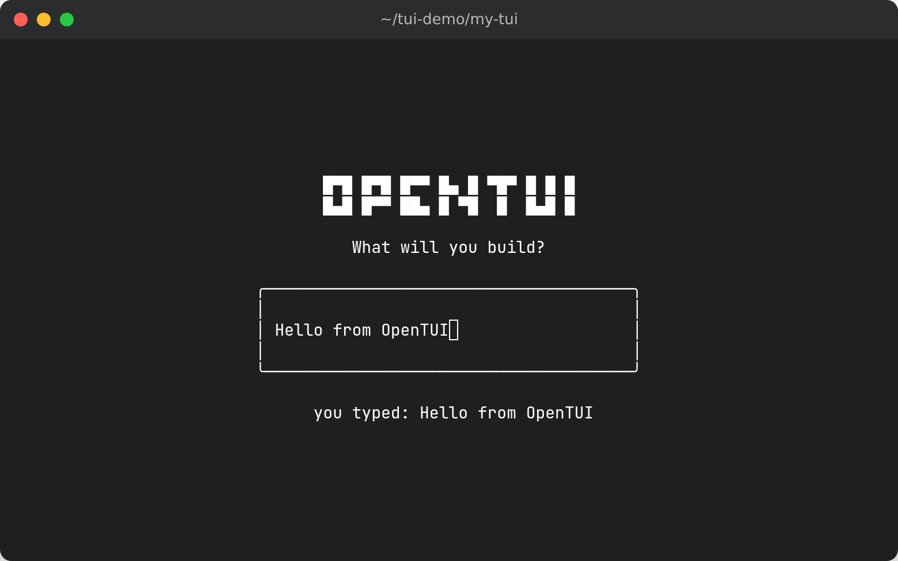
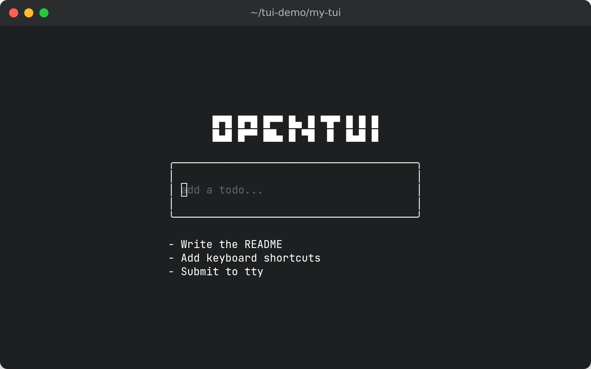
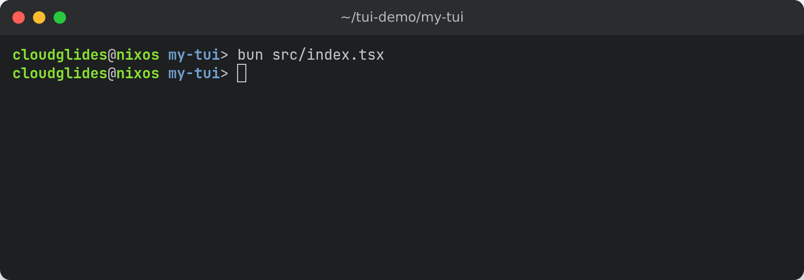

Opencode was one of the first AI harnesses i used, it was amazing in terms of ui and while researching about its source code i came across a library called opentui, its the core component used to develop opencode.

OpenTUI is a native terminal UI core written in Zig with TypeScript and Rust bindings.
It renders a component tree, lays it out with Flexbox, handles terminal input, and updates the cells that changed. OpenTUI's TypeScript packages call the Zig library through its native interface. OpenTUI powers OpenCode in production.

Its pretty much one of the easiest way to write TUIs using react, its also how i first got into TUIs though one of its cons are its bloated and feels heavy but its still amazing to just get into TUIs so im going to use it as the basic guide

for this guide my main machine is linux (nixos) so it might not be same for you, GOOGLE IT!

its actually a bit too easy? im going to use bun

run `bun create tui --template react` in your terminal and it should start an interactive wizard
after that fillout the basic deets



yipe we got a boilerplate, after that pretty much like your gazllion react applications run `bun run dev` in another terminal window (dont forget to cd into your directory)

the output should look something like:



yay we got our own TUI!!!! wonderful.. but this guide is a bit too small so im going to add a few more components

taking a look at our code in `src/index.tsx` its pretty much just basic react, you can either guess the syntax or open another amazing guide (i hate it) https://opentui.com/docs/bindings/react/

it should go over most things but does not really explain it very beginner friendly

:p next we add a textbox!

opentui has its own `<input>` thing, stick it in a box so it gets a border:

```tsx
<box width={40} borderStyle="rounded" padding={1}>
  <input placeholder="Type something..." />
</box>
```

i just replaced the inner `<box>` with this so its all centered under the logo:

```tsx
<box justifyContent="center" alignItems="center" gap={1}>
  <ascii-font font="tiny" text="OpenTUI" />
  <text attributes={TextAttributes.DIM}>What will you build?</text>
  <box width={40} borderStyle="rounded" padding={1}>
    <input placeholder="Type something..." />
  </box>
</box>
```



yay our own textbox

## Making the input work

If you try typing into the textbox now, nothing happens. OpenTUI only sends keyboard input to the focused component, and nothing is focused yet. Add the `focused` prop to the input:

```tsx
<input placeholder="Type something..." focused />
```

The template does not include React's type definitions, so your editor will show type errors once you start using hooks. Install them as a dev dependency:

```sh
bun add -d @types/react
```

## Reading the value

To use what the user types, store it in state. `onInput` is called on every keystroke with the current value:

```tsx
import { useState } from "react";

function App() {
  const [value, setValue] = useState("");

  return (
    <box alignItems="center" justifyContent="center" flexGrow={1}>
      <box justifyContent="center" alignItems="center" gap={1}>
        <ascii-font font="tiny" text="OpenTUI" />
        <text attributes={TextAttributes.DIM}>What will you build?</text>
        <box width={40} borderStyle="rounded" padding={1}>
          <input placeholder="Type something..." onInput={setValue} focused />
        </box>
        <text>you typed: {value}</text>
      </box>
    </box>
  );
}
```

The text below the input updates as you type.



## Building a todo list

Next, use `onSubmit` to handle the Enter key. Each submitted value is added to a list, and the input is cleared:

```tsx
function App() {
  const [value, setValue] = useState("");
  const [todos, setTodos] = useState<string[]>([]);

  return (
    <box alignItems="center" justifyContent="center" flexGrow={1}>
      <box justifyContent="center" alignItems="center" gap={1}>
        <ascii-font font="tiny" text="OpenTUI" />
        <box width={40} borderStyle="rounded" padding={1}>
          <input
            placeholder="add a todo..."
            value={value}
            onInput={setValue}
            onSubmit={() => {
              if (!value.trim()) return;
              setTodos([...todos, value]);
              setValue("");
            }}
            focused
          />
        </box>
        <box width={40}>
          {todos.map((todo, i) => (
            <text key={i}>- {todo}</text>
          ))}
        </box>
      </box>
    </box>
  );
}
```

A few details:

- `value={value}` makes the input controlled, which is what allows `setValue("")` to clear it after submitting.
- The handler reads from `value` state rather than the argument `onSubmit` receives. In OpenTUI 0.8 that argument is typed as `string | SubmitEvent`, so calling `.trim()` on it does not compile.
- Empty or whitespace-only entries are ignored.



## Exiting with Escape

Ctrl+C already quits the app. To add another key, use the `useKeyboard` and `useRenderer` hooks:

```tsx
import { createRoot, useKeyboard, useRenderer } from "@opentui/react";

function App() {
  const renderer = useRenderer();

  useKeyboard((key) => {
    if (key.name === "escape") {
      renderer.destroy();
    }
  });

  // rest of the component
}
```

`useKeyboard` receives every key press, and `renderer.destroy()` shuts the renderer down and restores the terminal. The same pattern works for any shortcut, for example checking `key.name === "d"` to delete an item.

Note that pressing Escape under `bun run dev` will appear to hang. The `dev` script runs `bun run --watch`, which keeps the process alive after the app exits so it can restart on the next file change. Press Ctrl+C to leave watch mode, or run the file directly to see the app exit normally:

```sh
bun src/index.tsx
```



## Next steps

You now have a TUI that accepts input, renders a list and exits cleanly. From here, some components and hooks worth looking at in the [React bindings docs](https://opentui.com/docs/bindings/react/):

- `<select>` for a menu navigated with the arrow keys
- `<scrollbox>` for content taller than the terminal
- `useTerminalDimensions()` for layouts that respond to the window size

Once your project is ready, submit it to tty.
